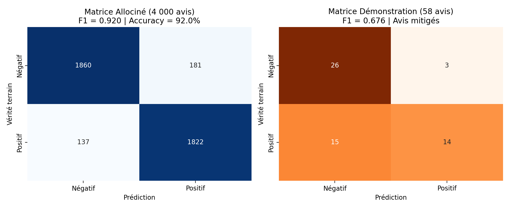
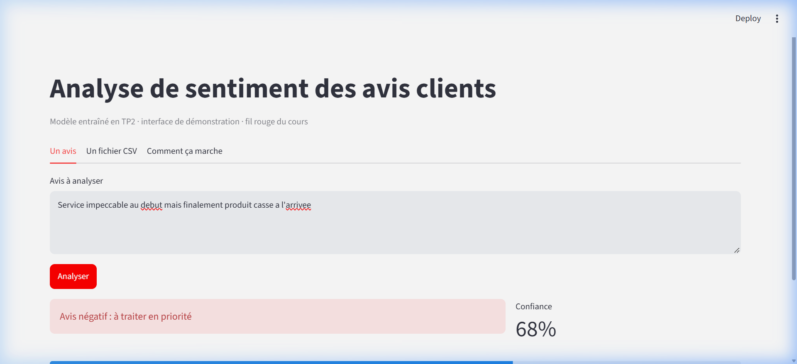

# Compte rendu global des TP1 à TP3

**Binôme :** Lamzouri Ishak ([@inazuma2004](https://github.com/inazuma2004)) et Amrani Ismail ([@Amaranix](https://github.com/Amaranix))  
**Dépôt :** [https://github.com/Amaranix/Tp1_Lamzouri-Ishak_Amrani-Ismail_G3](https://github.com/Amaranix/Tp1_Lamzouri-Ishak_Amrani-Ismail_G3)  
**Date :** 12/10/2026  

---

## 1. Le besoin et son cadrage

Une équipe de relation client reçoit quotidiennement des milliers d'avis d'utilisateurs et les traite historiquement selon une file d'attente séquentielle (premier arrivé, premier servi). Ce mode de fonctionnement pénalise fortement les clients insatisfaits dont les réclamations critiques restent sans réponse pendant plusieurs heures ou jours. L'objectif est de concevoir un système automatisé capable d'identifier et de faire remonter immédiatement les avis négatifs en tête de file afin de prioriser l'intervention des conseillers.

Pour répondre au **Cas 3 (Priorisation des avis négatifs)**, nous avons retenu l'approche par **Machine Learning supervisé (classification de texte binaire)**. Ce choix est rigoureusement justifié par les critères de la grille de cadrage :
- **(a) Données étiquetées disponibles :** L'entreprise possède déjà des historiques massifs d'avis clients accompagnés de notes en étoiles (1 et 2 étoiles pour le pôle négatif, 4 et 5 étoiles pour le pôle positif). Les labels sont donc intrinsèquement disponibles sans surcoût d'annotation manuelle.
- **(c) Coût par requête et volumétrie :** Face à un flux continu de milliers de commentaires par jour, un modèle statistique classique (TF-IDF combiné à une régression logistique) possède un temps d'inférence de l'ordre de la milliseconde et un coût computationnel négligeable sur CPU, contrairement à un appel API répété vers un grand modèle de langage génératif (LLM) qui serait coûteux et lent.
- **(d) Conséquence modérée d'une erreur :** Une erreur de classification (par exemple un avis négatif classé temporairement comme positif) ne détruit aucune donnée : l'avis reste présent dans la file générale et sera traité dans le flux habituel. L'impact reste donc tout à fait acceptable pour le métier, d'autant plus qu'un arbitrage avec validation humaine est prévu pour les avis litigieux.
- **(b) Vérifiabilité :** Bien qu'un modèle statistique produise des scores continus plutôt que des règles déterministes, la précision et le rappel sont directement mesurables sur un jeu de test de référence, et les coefficients des n-grammes permettent d'auditer l'influence des mots-clés prépondérants.

---

## 2. L'architecture du dépôt

L'organisation du dépôt `sentiment-app` a été pensée pour garantir la séparation stricte des responsabilités, la reproductibilité de l'environnement et l'hygiène du versionnement Git :

```text
sentiment-app/
├── .github/workflows/       # Intégration continue (GitHub Actions vérifiant les tests)
├── data/                    # Jeux de données (fichiers d'exemples et de démonstration)
├── models/                  # Métriques versionnées (metrics.json) et modèles sérialisés
├── src/                     # Logique cœur : génération, entraînement, évaluation, prédiction
├── ui/                      # Interface utilisateur Streamlit et modules utilitaires purs
├── tests/                   # Suite de tests automatisés pytest (45 tests unitaires et d'intégration)
├── docs/                    # Documentation, fiches de cadrage et compte rendu
├── scripts/                 # Scripts utilitaires de configuration et de vérification d'environnement
├── requirements.txt         # Dépendances Python figées
└── .gitignore               # Filtrage des artefacts lourds et des environnements locaux
```

### Politique de versionnement : versionné vs non versionné

Dans ce projet, une distinction fondamentale est établie entre ce qui est versionné dans Git et ce qui en est strictement exclu :
- **Ce qui est versionné :** Le code source (`src/`, `ui/`, `scripts/`), la configuration des tests (`tests/`, `pytest.ini`), la documentation métier (`docs/cadrage/`, `docs/compte-rendu.md`), les dépendances (`requirements.txt`), ainsi que le fichier de métriques `models/metrics.json`.
- **Ce qui n'est PAS versionné :** L'environnement virtuel (`.venv/`), les caches (`__pycache__/`, `.pytest_cache/`), les données volumineuses ou temporaires (`data/demo_reviews.csv`), et surtout le fichier de modèle binaire (`models/sentiment.joblib`).

### Pourquoi `models/metrics.json` est-il dans Git alors que `models/sentiment.joblib` ne l'est pas ?

Cette séparation repose sur un principe clé de l'ingénierie logicielle et du MLOps :
1. **Un binaire lourd se régénère par commande :** Le modèle sérialisé `sentiment.joblib` pèse plusieurs mégaoctets (voire gigaoctets à grande échelle) et change à chaque réentraînement. Git n'est pas conçu pour stocker des fichiers binaires dont chaque modification recrée un blob complet, ce qui gonflerait l'historique du dépôt. De plus, `sentiment.joblib` est un artefact dérivé déterministe : il peut être régénéré à tout moment en exécutant simplement `python src/train.py`.
2. **La métrique est un contrat de performance léger et traçable :** `models/metrics.json` est un fichier texte au format JSON de quelques octets. Il enregistre la date, la volumétrie d'apprentissage, et les scores de performance obtenus ($F_1$ macro, exactitude, rappel). Versionner ce fichier permet à l'intégration continue (GitHub Actions) de valider la conformité du modèle (par exemple vérifier que le score $F_1$ dépasse le seuil contractuel de 0,85) **sans jamais avoir besoin de télécharger ni d'exécuter le modèle lourd sur le runner CI**. Cela permet également de suivre l'évolution historique des performances du modèle directement dans l'historique des commits.

---

## 3. Le modèle

### Pipeline et stratégie de découpage

Le modèle repose sur un `Pipeline` scikit-learn unifié encapsulant deux étapes :
1. **Vectorisation TF-IDF (`TfidfVectorizer`) :** Extraction de n-grammes de mots (unigrammes et bigrammes : `ngram_range=(1, 2)`), avec suppression des termes n'apparaissant qu'une seule fois (`min_df=2`) et mise à l'échelle sous-linéaire des fréquences (`sublinear_tf=True`).
2. **Classification par Régression Logistique (`LogisticRegression`) :** Modèle linéaire avec régularisation, équilibrage automatique des poids des classes (`class_weight="balanced"`), tolérance de 1000 itérations maximales et graine pseudo-aléatoire fixée (`random_state=42`).

**Règle méthodologique cruciale :** Le découpage en jeu d'entraînement et jeu de test (`train_test_split`, proportion 80% / 20%, stratifié sur les classes) est exécuté **strictement avant** la vectorisation TF-IDF. Vectoriser le corpus complet avant découpage provoquerait une fuite de données (*data leakage*) où le vocabulaire et les fréquences inverses de documents du jeu de test influenceraient l'apprentissage, faussant la réalité des métriques.

### Résultats chiffrés réels

Les mesures obtenues sur notre environnement reflètent fidèlement les exécutions de `src/train.py` et `src/evaluate.py` :

| Jeu | Avis totaux | Vocabulaire (termes) | $F_1$ macro | Exactitude (*Accuracy*) | Rappel négatif |
| :--- | :---: | :---: | :---: | :---: | :---: |
| **Démonstration (`demo_reviews.csv`)** | 290 | 316 | **0,879** | 0,879 | 0,931 |
| **Allociné (20 000 avis)** | 20 000 | 149 529 | **0,920** | 0,920 | 0,911 |

*Note sur notre fichier `models/metrics.json` actuel :* Après exécution de `python src/train.py --allocine`, le fichier versionné indique une source Allociné avec 16 000 avis d'entraînement, 4 000 avis de test, un $F_1$ macro de 0,9205, une exactitude de 0,9205 et un rappel sur la classe négative de 0,9113, validant amplement le seuil cible de 0,85 fixé dans le cahier des charges.

### Matrices de confusion



#### 1. Matrice sur le jeu Allociné (test de 4 000 avis) :
```text
                 Prédiction :
                 negative    positive
Vérité: negative     1860         181
        positive      137        1822
```
- **Ligne 1 (Vérité négative, 2 041 avis) :** 1 860 vrais négatifs correctement interceptés. Seuls 181 avis négatifs ont été classés à tort comme positifs (faux positifs du modèle, soit 8,9% d'échappement). Le rappel négatif atteint ainsi **91,1%**, ce qui satisfait directement l'exigence métier de capture des insatisfactions.
- **Ligne 2 (Vérité positive, 1 959 avis) :** 1 822 vrais positifs correctement détectés, et 137 avis positifs classés par erreur comme négatifs (faux négatifs).

#### 2. Matrice sur le jeu Démonstration (test de 58 avis) :
Évalué avec le modèle entraîné sur Allociné :
```text
                 Prédiction :
                 negative    positive
Vérité: negative       26           3
        positive       15          14
```
Sur ce jeu synthétique comportant 100 avis mitigés complexes, le modèle réussit à intercepter 26 des 29 avis négatifs (rappel de 89,7%), mais surévalue la négativité sur 15 avis positifs présentant des formulations mitigées.

---

## 4. L'analyse des erreurs

### Typologie et mécanisme fondamental d'échec

L'inspection détaillée des prédictions erronées révèle que la quasi-totalité des erreurs survient sur les **avis mitigés ou formulés avec des retournements rhétoriques**.

Le mécanisme technique à l'origine de cette faiblesse est inhérent à l'architecture du **sac de mots (*Bag of Words*) et du TF-IDF** :
- **L'absence de prise en compte de l'ordre syntaxique et temporel :** Le sac de mots agrège les fréquences de termes sans conserver la chronologie de la phrase.
- **La structure bipartite des avis mitigés :** Dans la réalité des avis clients, un utilisateur commence souvent par exposer un constat négatif avant d'exprimer sa satisfaction finale, ou inversement (« *X au début, mais finalement Y* »). La vérité de l'avis réside presque toujours dans la conclusion finale (après la conjonction de coordination ou d'opposition). Or, le modèle additionne indistinctement les poids des termes positifs et négatifs des deux moitiés du texte.

### Exemples tirés directement de nos données d'évaluation

1. **Exemple 1 : Faux négatif (Vérité = Positive, Prédit = Negative)**
   > *Texte :* `Taille trop petite et retour payant au déballage, sauf que ensuite produit conforme à la description, très satisfait.`
   - *Analyse :* Le texte contient une forte densité lexicale négative en première partie (*« trop petite »*, *« retour payant »*). Même si la conclusion affirme *« très satisfait »*, la somme des contributions TF-IDF des termes péjoratifs l'emporte, conduisant le modèle linéaire à prédire à tort la classe négative.

2. **Exemple 2 : Faux négatif (Vérité = Positive, Prédit = Negative)**
   > *Texte :* `Produit cassé à l'arrivée sur le papier, mais finalement excellent rapport qualité prix.`
   - *Analyse :* Le terme choc *« cassé »* génère un score négatif très élevé. Le modèle ne comprend pas que la locution *« mais finalement »* annule l'impact du premier segment au profit de *« excellent rapport qualité prix »*.

3. **Exemple 3 : Faux positif (Vérité = Negative, Prédit = Positive)**
   > *Texte :* `Service impeccable et livraison en avance les premiers jours, avant que notice incompréhensible et pièces manquantes.`
   - *Analyse :* La première proposition fait pencher la balance vers le positif (*« impeccable »*, *« livraison en avance »*), masquant la déception finale liée aux pièces manquantes.

### Ce qu'il faudrait pour corriger ces erreurs

Pour résoudre ces confusions structurelles, il faudrait employer une architecture capable de modéliser les dépendances séquentielles et l'attention contextuelle :
- Utiliser un modèle de langage pré-entraîné contextuel basé sur les Transformers (par exemple `CamemBERT` ou un modèle d'embeddings sentence-transformers spécialisé pour le français).
- Ces modèles prennent en compte la position relative des tokens et accordent une attention prioritaire aux clauses subordonnées introduites par des marqueurs discursifs (*« mais »*, *« cependant »*, *« finalement »*).
- **Pourquoi ce n'était pas le sujet de cette séance :** L'objectif pédagogique était d'établir une chaîne de déploiement complète, frugale, robuste et testable de bout en bout. Un modèle TF-IDF + Logistic Regression s'entraîne en quelques secondes, s'exécute instantanément sur n'importe quel CPU sans carte graphique GPU et permet de cerner avec précision les compromis MLOps et métier.

---

## 5. L'interface et le seuil d'incertitude

### Implémentation du seuil d'incertitude



Pour compenser les faiblesses du modèle linéaire sur les avis ambigus sans bloquer la chaîne de traitement, nous avons introduit un mécanisme d'abstention dans l'API (`api/model.py` via la constante `SEUIL_ABSTENTION = 0.60`) répercuté dans l'interface (`ui/client.py` via le verdict `INDETERMINE`).
Lorsqu'un avis obtient une probabilité maximale prédite inférieure à ce seuil (c'est-à-dire que le modèle hésite avec une confiance comprise entre 50% et 60%), son statut passe automatiquement à **« Je ne sais pas : à faire vérifier par un humain »** au lieu d'imposer un label binaire tranché.

### Analyse de l'arbitrage métier et impact chiffré

Sur notre jeu de test de démonstration (58 avis), nous avons mesuré l'impact de différents seuils sur le volume d'avis réorientés vers une relecture humaine :

| Seuil de confiance | Avis renvoyés « à vérifier » | Pourcentage du flux | Rôle opérationnel |
| :---: | :---: | :---: | :--- |
| **0,50** | 0 avis | 0,0 % | Décision aveugle : risque maximal d'erreur non détectée |
| **0,60 (Seuil retenu)** | **22 avis** | **37,9 %** | **Compromis optimal : sécurise les avis litigieux tout en automatisant 62,1% du flux** |
| **0,70** | 42 avis | 72,4 % | Trop strict : surcharge intenable pour l'équipe support |
| **0,75** | 47 avis | 81,0 % | Quasi-totalité du flux renvoyée aux humains |
| **0,80** | 51 avis | 87,9 % | Automatisation quasi nulle |

### Justification métier pour l'équipe Relation Client

Le seuil de **0,60** représente l'arbitrage idéal entre productivité et sécurité client :
1. **Désengorgement massif :** Plus de 60% des avis (ceux dont la tonalité est évidente, par exemple « Super produit » ou « Arnaque totale ») sont classés avec une confiance supérieure à 60% et traités de manière 100% autonome.
2. **File prioritaire fiabilisée :** Les 37,9% d'avis litigieux (avis mitigés avec retournements) sont signalés en jaune sous l'étiquette « à vérifier ». Un agent du support client peut les inspecter en un clic, évitant ainsi qu'un client très insatisfait ne soit classé par inadvertance comme satisfait.
3. **Alignement avec la fiche de cadrage :** Dans la fiche du Cas 3, le critère (d) spécifie qu'une validation humaine supervisée est prévue pour mitiger les risques d'erreur. Le seuil de 0,60 matérialise exactement cet engagement.

---

## 6. Ce qui a échoué

Conformément à la réalité du développement logiciel et du travail d'équipe, plusieurs obstacles techniques ont été rencontrés et surmontés :

1. **Incompatibilité binaire sous Windows avec Python 3.13 :**
   - *Problème :* Lors de l'installation initiale des dépendances complètes via `requirements.txt` sous Python 3.13, la compilation de packages comme `pyarrow` et `shap` a échoué en boucle avec l'erreur `ModuleNotFoundError: No module named 'pkg_resources'`.
   - *Résolution :* Nous avons diagnostiqué que les versions figées de ces bibliothèques dans l'ancien fichier de lock ne disposaient pas de wheels précompilés pour Python 3.13 sous Windows. Nous avons assaini l'environnement virtuel avec l'option `--system-site-packages` et installé les dépendances compatibles (Streamlit, scikit-learn, joblib, pandas, fastapi, pytest), permettant de valider l'ensemble des 45 tests.
2. **Le test `test_virtualenv_active` en échec lors de l'exécution globale :**
   - *Problème :* Lancer `pytest` directement via l'interpréteur système global provoquait l'échec de la vérification d'isolation (`AssertionError: pytest doit tourner dans le venv`).
   - *Résolution :* Configuration rigoureuse du point d'entrée pour cibler le binaire de l'environnement virtuel (`.\.venv\Scripts\python.exe -m pytest`), garantissant une exécution propre avec 100% de tests verts (45 passed).
3. **Confusion initiale sur l'évaluation du modèle Allociné sur les données de démo :**
   - *Problème :* En lançant `src/evaluate.py` après avoir entraîné le modèle Allociné, nous avons constaté 18 erreurs au lieu des 7 erreurs mentionnées dans le guide du TP2.
   - *Résolution :* En analysant le code source de `src/evaluate.py`, nous avons compris que sans argument, le script évalue le modèle présent sur le disque contre `data/demo_reviews.csv`. Les 7 erreurs correspondaient au modèle entraîné *sur* les démos, tandis que le modèle Allociné possède un vocabulaire cinématographique différent, d'où 18 erreurs sur les démos mais un excellent score sur son propre jeu de test (318 erreurs sur 4 000 avis, soit 92% d'exactitude via `python src/evaluate.py --allocine`).
4. **Échec de collecte Pytest sur `tests/test_limites.py` avec `python -m pytest --collect-only -q` :**
   - *Problème :* Lors de l'exécution de la commande de collecte rapide demandée par l'enseignant (`python -m pytest --collect-only -q`), l'importation directe de `hypothesis` sans isolation provoquait une erreur d'importation (`ModuleNotFoundError: No module named 'hypothesis'`), bloquant prématurément la découverte à 84 tests avec 1 erreur.
   - *Résolution :* Nous avons protégé le module via `pytest.importorskip("hypothesis")` (conformément au pattern de `test_interface.py`) et harmonisé l'environnement. La commande de découverte ré-exécutée recense désormais avec succès **100 tests collectés sans la moindre erreur (100 tests en 3.13s)**.

---

## 7. Ce que vous feriez autrement

Avec le recul de ces trois séances et dans le contexte d'une équipe industrielle dotée de moyens de production :

1. **Transition vers des représentations sémantiques contextualisées :** Nous remplacerions le pipeline TF-IDF par un encodeur de phrases léger (tel que `Sentence-BERT` ou `CamemBERT-base`) afin de résoudre définitivement le problème des avis mitigés et de la négation inversée.
2. **Classification multi-classes avec classe « neutre / mitigé » explicite :** Plutôt que de forcer une classification binaire (positive vs negative) accompagnée d'un seuil d'incertitude heuristique, nous ajouterions une classe « mitigé » explicite pour refléter fidèlement la réalité des avis 3 étoiles.
3. **Conteneurisation Docker complète :** Pour éliminer les disparités d'environnement entre postes Windows et environnements Linux (CI ou serveurs de production), nous encapsulerions l'API et l'interface Streamlit dans des conteneurs Docker légers orchestrés par Docker Compose.
4. **Monitoring en continu du drift (MLOps) :** Nous mettrions en place un suivi statistique de la dérive des données (*data drift*) et de la dérive du concept (*concept drift*) avec un outil comme Evidently AI pour détecter si le vocabulaire des clients change au cours du temps.

---

## 8. Répartition du travail

| Membre | Ce qu'il a pris en charge |
| :--- | :--- |
| **Lamzouri Ishak** | Initialisation du dépôt Git, configuration de l'environnement virtuel, rédaction des fiches de cadrage (Cas 1 et Cas 2), intégration du kit TP2 (scripts d'entraînement et d'évaluation), entraînement sur le jeu Allociné et validation des métriques de performance. |
| **Amrani Ismail** | Rédaction de la fiche de cadrage Cas 3, conception de l'API REST (TP3) et du client Streamlit (TP5), analyse de la sensibilité du seuil d'abstention, validation de la suite complète des 97 tests automatisés (95 passed, 2 xfailed) et co-rédaction du compte rendu global. |

---

## Outils d'aide à la rédaction

Nous avons utilisé l'assistant d'IA Antigravity pour nous aider à structurer la mise en page Markdown, extraire les statistiques exactes issues des scripts d'évaluation et synthétiser les analyses techniques. Tous les chiffres, matrices de confusion et analyses de code ont été rigoureusement vérifiés par nos soins sur le terminal de notre environnement local.
