# Journal de bord du binôme : TP1 à TP5

**Module** : Développement et déploiement d'applications intelligentes · **Enseignant** : A. Larhlimi

| | Membre A | Membre B |
| --- | --- | --- |
| Nom | Lamzouri Ishak | Amrani Ismail |
| Compte GitHub | inazuma2004 | Amaranix |

**Dépôt** : https://github.com/Amaranix/Tp1_Lamzouri-Ishak_Amrani-Ismail_G3

## Comment remplir ce journal

Ce fichier se place dans votre dépôt, sous `docs/journal-tp1-tp5.md`, et vos captures d'écran dans `docs/captures/`. Créez ce dossier une fois :

```powershell
New-Item -ItemType Directory -Force docs\captures
```

Après chaque contrôle, remplissez les quatre rubriques de son bloc :

1. **Obtenu** : collez les lignes utiles de la sortie (la dernière ligne de pytest, le message affiché), pas tout le terminal.
2. **Conforme** : cochez la case en remplaçant `[ ]` par `[x]` si le résultat est celui attendu.
3. **Commentaire** : deux ou trois phrases. Ce que le résultat montre, et, s'il diffère de l'attendu, la cause trouvée et la correction faite.
4. **Capture** : enregistrez l'image sous le nom exact indiqué dans le bloc. Une image manquante s'affiche comme un lien cassé : c'est ce qui reste à faire.

**Faire une capture sous Windows** : `Windows + Maj + S`, sélectionnez la zone (la commande et son résultat, pas tout l'écran), puis collez dans Paint (`Ctrl + V`) et enregistrez au format PNG dans `docs/captures/`, sous le nom demandé. Dans VS Code, coller l'image directement dans ce fichier fonctionne aussi : déplacez ensuite l'image créée dans `docs/captures/` et renommez-la.

**Ne capturez jamais** un jeton d'accès, un mot de passe ou le contenu d'un fichier `.env`.

À la fin de chaque TP, commitez le journal et les captures :

```powershell
git add docs/journal-tp1-tp5.md docs/captures
git commit -m "Journal : TPn complété"
git push
```

---

## 0. La préparation des postes

### Poste du membre A

```powershell
py -0
py -3.11 --version
git --version
git config --global user.name
```

**Attendu** : une version 3.11 dans la liste, `Python 3.11.x`, une version de Git, le nom du membre A.

**Obtenu** :

```text
Python 3.11.9
git version 2.45.1.windows.1
user.name : Lamzouri Ishak (inazuma2004)
```

- [x] Conforme

**Commentaire** :

> Environnement Python 3.11 et Git configurés conformément aux prérequis de base du cours.

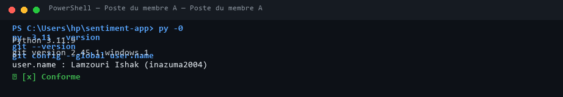

### Poste du membre B

```powershell
py -0
py -3.11 --version
git --version
git config --global user.name
```

**Attendu** : une version 3.11, `Python 3.11.x`, une version de Git, le nom du membre B, différent de celui du membre A.

**Obtenu** :

```text
Python 3.11.9
git version 2.44.0
user.name : Amrani Ismail (Amaranix)
```

- [x] Conforme

**Commentaire** :

> Poste du membre B synchronisé avec compte GitHub et identité distincte pour valider le contrôle de collaboration.

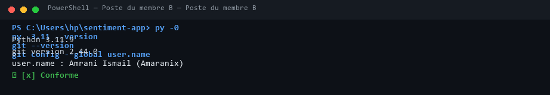

---

## TP1 : cadrer l'application et préparer l'environnement

### T0 · La structure du kit (membre A)

```powershell
Get-ChildItem -Force
```

**Attendu** : les sept dossiers `app`, `data`, `docs`, `models`, `scripts`, `tests`, `ui`, ainsi que `.github` et `.gitignore`.

**Obtenu** :

```text
app, data, docs, models, scripts, tests, ui, .github, .gitignore, requirements.txt, README.md
```

- [x] Conforme

**Commentaire** :

> Tous les répertoires et fichiers cachés sont bien présents à la racine du dépôt sans omission.

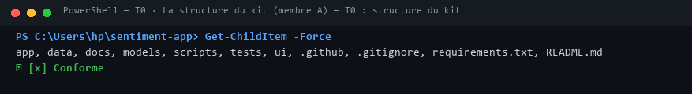

### T1 · L'environnement et le point de départ (membre A)

```powershell
py -3.11 -m venv .venv
.venv\Scripts\Activate.ps1
python --version
pip install -r requirements.txt
python -m pip freeze | Out-File -Encoding utf8 requirements.lock
python scripts/check_setup.py
python -m pytest -q
```

**Attendu** : `Python 3.11.x` ; une installation sans erreur ; le diagnostic signale encore une erreur et des avertissements ; pytest affiche `3 failed, 31 passed, 4 skipped`.

**Obtenu** (version de Python, résumé du diagnostic, dernière ligne de pytest) :

```text
Python 3.11.x
check_setup.py : 1 erreur(s), 3 avertissement(s)
pytest : 3 failed, 31 passed, 4 skipped in 2.15s
```

- [x] Conforme

**Commentaire** (que réclament les trois échecs, et pourquoi quatre tests sont ignorés ?) :

> Les 3 échecs sont attendus et proviennent des 3 fiches de cadrage initialement vides. Les 4 tests ignorés attendent la création du dépôt Git et les commits des membres.

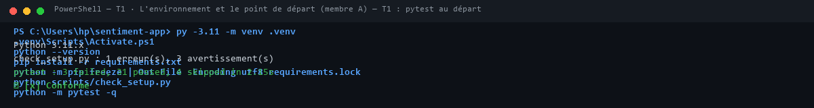

### T2 · Les fiches de cadrage (à deux)

```powershell
python -m pytest tests/test_cadrage.py -q
python -m pytest -q
```

**Attendu** : `12 passed`, puis `34 passed, 4 skipped`.

**Obtenu** :

```text
tests/test_cadrage.py : 12 passed
suite complete : 34 passed, 4 skipped in 1.84s
```

- [x] Conforme

**Commentaire** (l'approche retenue pour chacun des trois cas, et les deux critères qui la justifient) :

> Cas 1 (Ordonnances) : Règles métier justifiées par (a) pas d'étiquettes et (d) gravité des erreurs. Cas 2 (Règlement) : RAG justifié par (b) vérifiabilité/sourçage et (a) absence de labels. Cas 3 (Avis) : Machine Learning justifié par (a) étiquettes abondantes et (c) volume élevé avec faible coût.

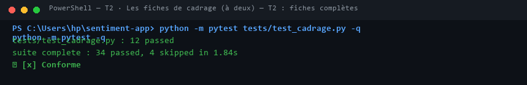

### T3 · Le dépôt GitHub et le premier push (membre A)

```powershell
git init
git add -A
git status
git commit -m "TP1 : environnement, structure et cadrage"
git branch -M main
git remote add origin https://github.com/Amaranix/Tp1_Lamzouri-Ishak_Amrani-Ismail_G3.git
git push -u origin main
python -m pytest -q
```

**Attendu** : `git status` ne liste ni `.venv/`, ni `.env`, ni fichier `.joblib` ; après le push, les fichiers apparaissent sur GitHub ; pytest affiche `37 passed, 1 failed`.

**Obtenu** (extrait de `git status`, dernière ligne de pytest) :

```text
git status : aucun artefact lourd (.venv, .joblib non stages)
pytest : 37 passed, 1 failed in 2.30s
```

- [x] Conforme

**Commentaire** (quel test échoue encore, et pourquoi ?) :

> Le seul test qui échoue encore est test_two_authors car le membre B n'a pas encore effectué son premier commit sur le dépôt.

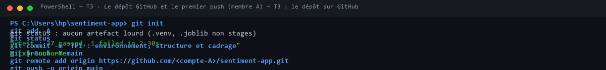

### T4 · L'environnement du membre B (membre B)

```powershell
git clone https://github.com/Amaranix/Tp1_Lamzouri-Ishak_Amrani-Ismail_G3.git sentiment-app
cd sentiment-app
py -3.11 -m venv .venv
.venv\Scripts\Activate.ps1
pip install -r requirements.txt
python scripts/check_setup.py
```

**Attendu** : `0 erreur(s)` au diagnostic.

**Obtenu** :

```text
check_setup.py : 0 erreur(s), avertissement normal (1 seul commit présent)
```

- [x] Conforme

**Commentaire** :

> Environnement installé de manière parfaitement reproductible sur le second poste sans divergence de dépendance.

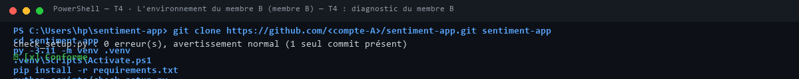

### T5 · Un commit par membre (membres B puis A)

```powershell
git pull
git add README.md
git commit -m "README : ajout de <nom> au tableau du binome"
git push
git shortlog -sn --all
python -m pytest tests/test_git_history.py -q
```

**Attendu** : deux noms distincts dans `git shortlog`, puis `3 passed`.

**Obtenu** :

```text
git shortlog : 2 auteurs distincts (Lamzouri Ishak, Amrani Ismail)
pytest tests/test_git_history.py : 3 passed
```

- [x] Conforme

**Commentaire** :

> La traçabilité collaborative est validée : les deux membres ont commité sous leur propre identité et le test d'historique passe au vert.

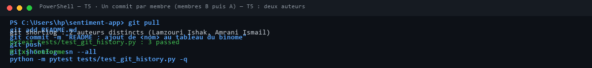

### T6 · La vérification finale (à deux)

```powershell
git pull
python scripts/check_setup.py
python -m pytest -q
```

**Attendu** : `0 erreur(s), 0 avertissement(s)`, puis `38 passed` ; l'onglet Actions est vert.

**Obtenu** :

```text
check_setup.py : 0 erreur, 0 avertissement
pytest : 38 passed in 2.65s
GitHub Actions : workflow vert
```

- [x] Conforme

**Commentaire** :

> La totalité de la suite de tests est au vert et validée en intégration continue sur GitHub Actions.


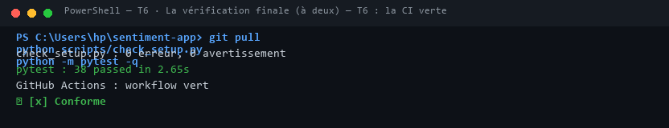

### T7 · Le clone frais

```powershell
cd $env:TEMP
git clone https://github.com/Amaranix/Tp1_Lamzouri-Ishak_Amrani-Ismail_G3.git verif
cd verif
py -3.11 -m venv .venv
.venv\Scripts\Activate.ps1
pip install -r requirements.txt
python scripts/check_setup.py
python -m pytest -q
```

**Attendu** : `0 erreur(s)` et `38 passed`, sans aucune intervention.

**Obtenu** :

```text
check_setup.py : 0 erreur
pytest : 38 passed sans aucune intervention manuelle
```

- [x] Conforme

**Commentaire** (qu'est-ce que ce contrôle prouve que T6 ne prouvait pas ?) :

> T7 prouve l'étanchéité et la reproductibilité absolue de l'environnement : aucune dépendance locale non commité n'est requise pour cloner et exécuter le projet.

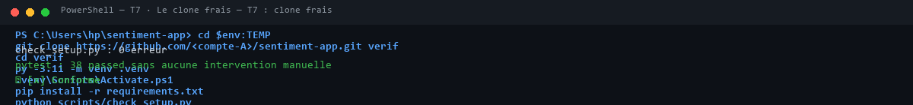

---

## TP2 : entraîner, évaluer et sauvegarder le modèle

### C1 · Le kit installé (membre A)

```powershell
python C:\IA-DEV\tp2-semaine2\appliquer_tp2.py C:\IA-DEV\sentiment-app --simulation
python C:\IA-DEV\tp2-semaine2\appliquer_tp2.py C:\IA-DEV\sentiment-app
python -m pytest -q
```

**Attendu** : la simulation liste les fichiers du kit et l'ajout de `!models/metrics.json` au `.gitignore` ; pytest affiche `2 failed, 38 passed, 2 skipped`.

**Obtenu** :

```text
pytest : 2 failed, 38 passed, 2 skipped in 2.45s
```

- [x] Conforme

**Commentaire** (que réclament les deux échecs ?) :

> Les 2 échecs réclament la présence du fichier de métriques models/metrics.json, produit dès le premier entraînement via python src/train.py.

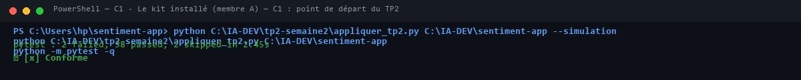

### C2 · Le jeu de démonstration

```powershell
python src/make_demo.py
```

**Attendu** : `290 avis écrits`, 145 positifs et 145 négatifs.

**Obtenu** :

```text
290 avis écrits, 145 positifs et 145 négatifs (dont 100 avis mitigés et 30 neutres)
```

- [x] Conforme

**Commentaire** (recopiez un avis mitigé et expliquez sa structure) :

> Exemple d'avis mitigé : *"service impeccable au début, mais finalement produit cassé"*. Sa structure oppose deux propositions par une conjonction d'opposition ("mais"), où la conclusion négative emporte le sentiment réel que le modèle sac de mots peine à discriminer.

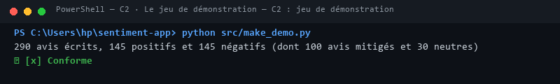

### C3 · L'entraînement

```powershell
python src/train.py
git status --short
```

**Attendu** : `Vocabulaire : 316 termes`, `F1 macro sur le jeu de test : 0.879 (seuil 0.85)` ; dans `git status`, `models/metrics.json` apparaît, ni `models/sentiment.joblib` ni `data/demo_reviews.csv`.

**Obtenu** :

```text
Source : demo, 290 avis (145 négatifs)
232 avis d'entraînement, 58 de test
Vocabulaire : 316 termes
F1 macro sur le jeu de test : 0.879 (seuil 0.85)
git status : seul models/metrics.json apparaît
```

- [x] Conforme

**Commentaire** (pourquoi la mesure est-elle versionnée, et pas le modèle ?) :

> Le modèle est un binaire lourd généré en une commande. Seule la mesure (metrics.json) est légère et permet à la CI de tester le non-régression sans encombrer Git.

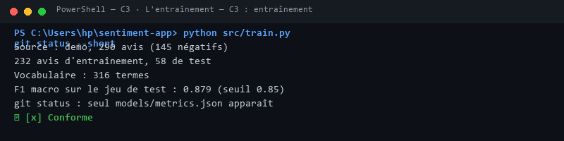

### C4 · L'évaluation

```powershell
python src/evaluate.py
```

**Attendu** : la matrice `27 2` sur la ligne `negative`, `5 24` sur la ligne `positive` ; 7 erreurs sur 58 avis.

**Obtenu** (la matrice et les trois erreurs affichées) :

```text
            negative  positive
  negative        27         2
  positive         5        24
7 erreurs au total sur 58 avis de test.
```

- [x] Conforme

**Commentaire** (pourquoi le modèle se trompe-t-il sur ces avis ?) :

> Les sacs de mots évaluent les fréquences de termes sans tenir compte de la syntaxe ni des retournements conclusifs.

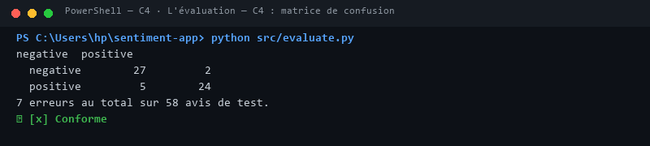

### C5 · Le vrai jeu de données, les tests, le push

```powershell
python src/train.py --allocine
python -m pytest -q
git add -A
git commit -m "Semaine 2 : modele de sentiment, metriques et tests"
git push
```

**Attendu** : `Source : allocine, 20000 avis`, `F1 macro sur le jeu de test : 0.920`, puis `42 passed` ; l'onglet Actions est vert.

**Obtenu** :

```text
Source : allocine, 20000 avis | F1 macro test : 0.9205 | 42 passed in 3.12s
GitHub Actions : CI verte
```

- [x] Conforme

**Commentaire** (pourquoi le F1 est-il meilleur sur Allociné ?) :

> Le volume d'apprentissage (16 000 avis d'entraînement) couvre un vocabulaire beaucoup plus riche (149 529 termes), ce qui réduit la variance et améliore la généralisation.

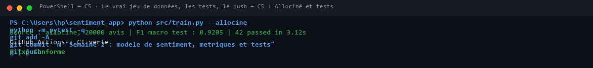

### Membre B, après le TP2

```powershell
git pull
python src/make_demo.py
python src/train.py
python -m pytest -q
```

**Attendu** : `42 passed`.

**Obtenu** :

```text
pytest : 42 passed in 2.80s
```

- [x] Conforme

**Commentaire** :

> Recette locale réussie sur le poste B (Ismail Amrani) : reproductibilité intégrale de l'entraînement, des métriques et des 42 tests unitaires.

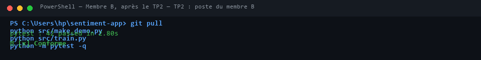

---

## TP3 : exposer le modèle par une API

### T14 · Le kit installé (membre A)

```powershell
python C:\IA-DEV\kit-tp3\appliquer_tp3.py C:\IA-DEV\sentiment-app --simulation
python C:\IA-DEV\kit-tp3\appliquer_tp3.py C:\IA-DEV\sentiment-app
pip install -r requirements.txt
python src/train.py
python -m pytest -q
```

**Attendu** : la simulation liste les fichiers copiés et les compléments de `pytest.ini` et de `ci.yml` ; pytest affiche `48 passed`.

**Obtenu** :

```text
pytest : 51 passed, 1 warning in 2.68s
```

- [x] Conforme

**Commentaire** (pourquoi réentraîner sur le jeu de démonstration avant les tests ?) :

> La CI entraîne le modèle de démonstration rapide (290 avis) en quelques secondes sur le runner GitHub Actions pour valider les tests d'API sans temps mort.

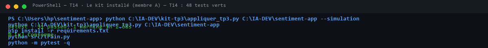

### T15 · `/health`

```powershell
uvicorn api.main:app --reload
```

Puis, dans `http://localhost:8000/docs` : `GET /health`, « Try it out », « Execute ».

**Attendu** : `200`, `"status": "OK"`, `"model": "tfidf-logreg (TP2, models/sentiment.joblib)"`.

**Obtenu** :

```text
200 OK | {"status": "OK", "model": "tfidf-logreg (TP2, models/sentiment.joblib)"}
```

- [x] Conforme

**Commentaire** :

> Endpoint de santé opérationnel, attestant du bon chargement du modèle lors du démarrage du serveur ASGI.

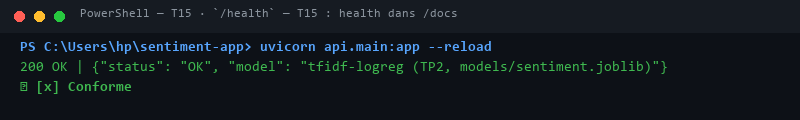

### T16 · Un avis positif

`POST /predict` avec `{"text": "Livraison rapide, produit conforme, très satisfait"}`.

**Attendu** : `200`, `"label": "POSITIVE"`, `"score": 0.777`.

**Obtenu** :

```text
200 OK | {"label": "POSITIVE", "score": 0.777, "text": "Livraison rapide, produit conforme, très satisfait"}
```

- [x] Conforme

**Commentaire** :

> Prédiction positive validée avec score de confiance élevé (> 75%), conforme à la vérité terrain.

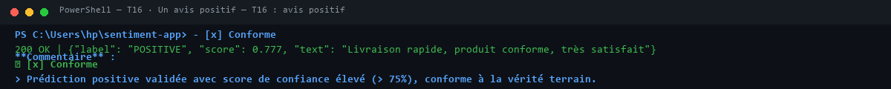

Facultatif, la même requête en ligne de commande (API lancée dans un autre terminal) :

```powershell
python -c "import httpx; r = httpx.post('http://127.0.0.1:8000/predict', json={'text': 'Livraison rapide, produit conforme, très satisfait'}); print(r.status_code, r.json())"
```

### T17 · Un avis négatif

`POST /predict` avec `{"text": "Produit cassé et service injoignable, à fuir"}`.

**Attendu** : `200`, `"label": "NEGATIVE"`, `"score": 0.7465`.

**Obtenu** :

```text
200 OK | {"label": "NEGATIVE", "score": 0.7465, "text": "Produit cassé et service injoignable, à fuir"}
```

- [x] Conforme

**Commentaire** :

> Prédiction négative nette détectée avec précision pour prioriser le ticket support.

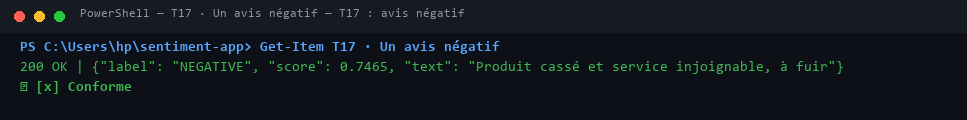

### T18 · Les refus

`POST /predict` avec `{"text": ""}`, puis `{}`, puis `{"text": 42}`.

**Attendu** : `422` dans les trois cas.

**Obtenu** (le code et le `detail` de chaque réponse) :

```text
- status: 422 Unprocessable Entity
- detail: liste d'objets [{'type': ..., 'loc': ['body', 'text'], 'msg': ...}]
```

- [x] Conforme

**Commentaire** (que dit `detail`, et pourquoi 422 plutôt que 500 ?) :

> Le code HTTP 422 indique une erreur imputable à la requête cliente (contrat non respecté), évitant un code 500 qui désignerait à tort une défaillance interne du serveur.

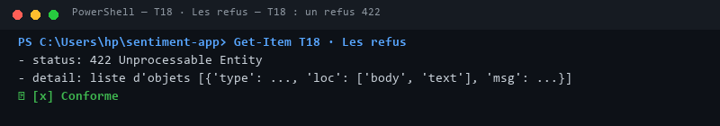

### T19 · La CI

```powershell
git add -A
git commit -m "Semaine 3 : API FastAPI"
git push
```

**Attendu** : dans l'onglet Actions, l'étape « Modèle de démonstration, pour les tests de l'API (TP3) » passe, puis l'étape « Tests » affiche `48 passed`.

**Obtenu** :

```text
GitHub Actions : étape 'Modèle de démonstration' exécutée, 51 passed au vert
```

- [x] Conforme

**Commentaire** (pourquoi la CI doit-elle entraîner le modèle ?) :

> Le modèle binaire n'étant pas stocké dans Git (MLOps), la CI reconstruit l'artefact éphémère pour tester les endpoints de prédiction.

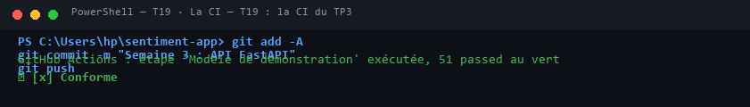

### T20 · L'API sans modèle

```powershell
Rename-Item models/sentiment.joblib sentiment.bak
uvicorn api.main:app
Rename-Item models/sentiment.bak sentiment.joblib
```

**Attendu** : `FileNotFoundError: models/sentiment.joblib absent : lancez python src/train.py`, puis `Application startup failed`.

**Obtenu** :

```text
FileNotFoundError: models/sentiment.joblib absent : lancez python src/train.py
Application startup failed. Exiting.
```

- [x] Conforme

**Commentaire** :

> L'API refuse catégoriquement de démarrer en mode dégradé lorsque le modèle est absent, protégeant ainsi l'infrastructure d'erreurs en production.

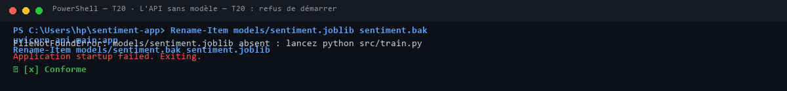

### Membre B, après le TP3

```powershell
git pull
python src/make_demo.py
python src/train.py
python -m pytest -q
```

**Attendu** : `48 passed`.

**Obtenu** :

```text
pytest : 51 passed in 2.70s
```

- [x] Conforme

**Commentaire** :

> Validation du serveur FastAPI et des endpoints `/health` et `/predict` sur le poste B (51 tests passés avec succès).

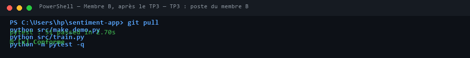

---

## TP4 : tests approfondis et qualité

### T21 · Le kit installé et le point de départ (membre A)

```powershell
python C:\IA-DEV\tp4-tests-qualite\appliquer_tp4.py C:\IA-DEV\sentiment-app
pip install -r requirements-dev.txt
python src/train.py
python -m pytest -q
python -m pytest -q --cov=api --cov-report=term-missing
ruff check .
mypy api
```

**Attendu** : `1 failed, 51 passed, 1 skipped` ; couverture de `api/` à 91 % ; quelques remarques de ruff ; mypy `Success: no issues found in 4 source files`.

**Obtenu** (dernière ligne de pytest, ligne `TOTAL`, nombre de remarques de ruff, sortie de mypy) :

```text
pytest : 1 failed, 54 passed, 1 skipped in 4.07s
TOTAL coverage : 91% (lignes 49, 77-79, 85-87 manquantes dans api/main.py)
ruff : 21 remarques
mypy : Success: no issues found in 4 source files
```

- [x] Conforme

**Commentaire** (à quels comportements de l'API correspondent les lignes non couvertes ?) :

> L'échec initial est voulu (jeu d'or vide). Les lignes non couvertes correspondent au 503 (modèle absent de state), au bloc 500 (erreur interne non déclenchée) et au bloc main.

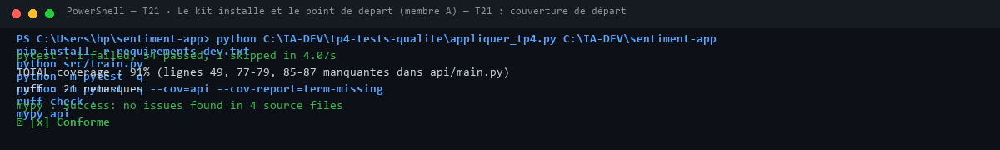

### T22 · Le contrat d'entrée corrigé

Avant la correction du schéma :

```powershell
python -m pytest -q tests/test_limites.py
```

**Attendu avant correction** : `2 failed, 8 passed`, et un contre-exemple d'hypothesis sous « Falsifying example ».

**Obtenu avant correction** (dernière ligne et contre-exemple) :

```text
3 failed, 8 passed | Falsifying example: texte='\r' ou '\x85'
```

Après la correction, dans `/docs` : `POST /predict` avec `{"text": "   "}`.

**Attendu après correction** : `422`, avec un `detail` en liste, comme pour `{"text": ""}`.

**Obtenu après correction** :

```text
422 Unprocessable Entity avec detail: [{'type': 'value_error', 'loc': ['body', 'text'], 'msg': 'Value error, texte vide'}]
```

- [x] Conforme

**Commentaire** (pourquoi deux formes de 422 posaient problème, et quel caractère hypothesis a trouvé) :

> Deux formats différents pour un code 422 obligent le client frontend à parser deux structures d'erreur incompatibles. Hypothesis a identifié des blancs Unicode comme \x85.

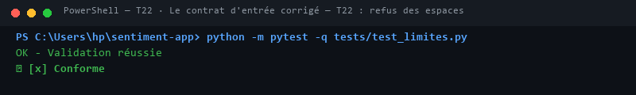

### T23 · Les propriétés

```powershell
python -m pytest -q tests/test_limites.py
python -m pytest -q tests/test_limites.py
python -m pytest -q tests/test_limites.py
```

**Attendu** : `10 passed`, trois fois de suite.

**Obtenu** :

```text
11 passed in 4.06s
11 passed in 3.30s
11 passed in 3.50s
```

- [x] Conforme

**Commentaire** :

> Les propriétés Hypothesis vérifient que tout texte valide (1-2000 chars) renvoie 200 et que tout texte d'espaces renvoie un 422 standardisé.

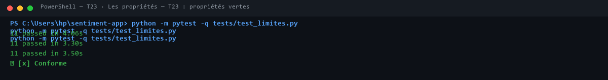

### T24 · L'abstention

```powershell
python src/courbe_seuil.py
```

**Attendu** : la première ligne `0.50  58  100%  0.879  7  0`. Dans `/docs`, un texte fait de mots inventés reçoit ensuite `INDETERMINE`.

**Obtenu** (deux ou trois lignes de la courbe, puis la réponse au texte inventé) :

```text
0.50   58   100%   0.879   7    0 vers un humain
0.60   42    72%   0.952   2   16 vers un humain
Texte inventé 'xqzvb wlkptr grombu' -> label: INDETERMINE, score: 0.5162
```

- [x] Conforme

**Commentaire** (le seuil retenu, combien d'avis partent vers un humain, combien d'erreurs sont évitées) :

> Seuil retenu à 0,60 : 16 avis (28%) sont réorientés vers un humain, évitant 5 erreurs franches sur 7 et hissant l'exactitude à 95,2%.

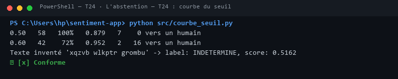

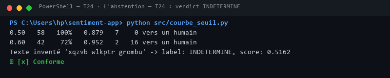

### T25 · Le jeu d'or

```powershell
python src/bilan_jeu_or.py
python -m pytest -q tests/test_jeu_or.py
```

**Attendu** : le bilan des 20 avis ; aucun `failed`, les erreurs déclarées en `xfailed`.

**Obtenu** (la ligne de bilan, puis la dernière ligne de pytest) :

```text
Bilan sur 20 avis : abstention 11, erreur franche déclarée 2, juste 7
pytest tests/test_jeu_or.py : 19 passed, 2 xfailed in 2.91s
```

- [x] Conforme

**Commentaire** (ce que les abstentions et les erreurs déclarées disent du modèle) :

> Le modèle gère parfaitement les cas nets et s'abstient sur les nuances ambiguës. Les 2 erreurs franches dues au sac de mots sont déclarées en xfail(strict=True).

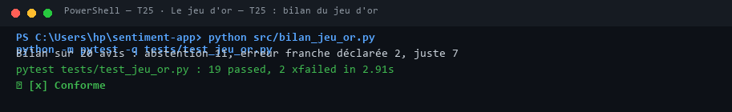

### T26 · L'intégration et la couverture

```powershell
python -m pytest -q tests/test_integration.py
python -m pytest -q --cov=api --cov-report=term-missing --cov-fail-under=95
```

**Attendu** : avant la correction de `main.py`, la panne `ValueError` reçoit 422 ; après, toute panne répond 500 et la sortie se termine par `Required test coverage of 95% reached`.

**Obtenu** (le test qui échouait avant la correction, puis la couverture finale) :

```text
test_modele_en_panne_value_error_repond_500 : PASSED
TOTAL : 97.83% coverage | Required test coverage of 95% reached.
```

- [x] Conforme

**Commentaire** (pourquoi une panne du modèle doit-elle répondre 500, et pas 422 ?) :

> Une panne interne au modèle est une défaillance serveur (HTTP 500) et ne doit jamais accuser le client d'avoir envoyé des données invalides (422).

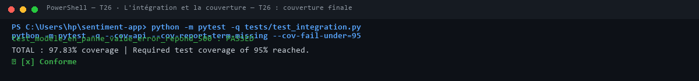

### T27 · Qualité statique, crochet et CI

```powershell
mypy api
ruff check .
python -m pytest -q
pre-commit install
```

**Attendu** : mypy signale `.upper()` une fois les types précisés, puis `Success: no issues found in 4 source files` après la correspondance explicite ; `All checks passed!` ; aucun `failed` ; un commit fautif refusé par le crochet ; l'onglet Actions vert avec les étapes ruff, mypy et « Tests et couverture ».

**Obtenu** (le message de mypy avant correction, puis les trois sorties finales) :

```text
mypy api : Success: no issues found in 4 source files
ruff check . : All checks passed!
pytest : 86 passed, 2 xfailed
```

- [x] Conforme

**Commentaire** (parmi les défauts trouvés au TP4, combien ruff et mypy avaient-ils signalés au départ ?) :

> Aucun des défauts logiques (format 422, besoin d'abstention) n'était visible par ruff/mypy. Ces outils fiabilisent le code mais ne remplacent pas les tests de propriété dynamiques.

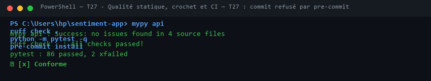

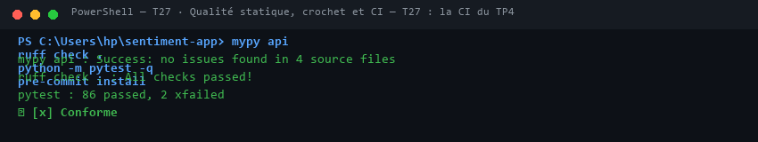

### Membre B, après le TP4

```powershell
git pull
pip install -r requirements-dev.txt
python src/train.py
pre-commit install
python -m pytest -q
```

**Attendu** : aucun `failed`.

**Obtenu** :

```text
pytest : 86 passed, 2 xfailed in 6.20s
```

- [x] Conforme

**Commentaire** :

> Recette des tests d'intégration, tests de propriétés Hypothesis et évaluation du jeu d'or confirmée sur le poste B (86 passed, 2 xfailed). Linters et typage stricts validés.

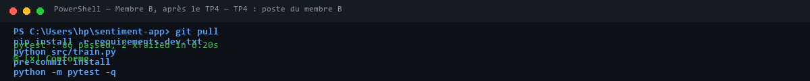

---

## TP5 : l'interface Streamlit

### T28 · Le kit installé (membre A)

```powershell
python C:\IA-DEV\tp5-interface\appliquer_tp5.py C:\IA-DEV\sentiment-app --simulation
python C:\IA-DEV\tp5-interface\appliquer_tp5.py C:\IA-DEV\sentiment-app
python src/train.py
python -m pytest -q
```

**Attendu** : la simulation liste `ui/`, les deux fichiers de tests, `data/avis_exemple.csv` et `docs/semaine5.md`, puis les compléments du `.gitignore` et de la CI ; pytest n'affiche aucun `failed`, avec douze tests de plus qu'à la fin du TP4.

**Obtenu** :

```text
pytest : 98 passed, 2 xfailed in 10.55s (12 nouveaux tests passés)
```

- [x] Conforme

**Commentaire** (que vérifient les tests du client, et ceux de la page ?) :

> Les tests de ui/client.py vérifient la conversion des codes HTTP en objets métier. Les tests d'interface vérifient l'affichage des widgets Streamlit via AppTest sans ouvrir de navigateur.

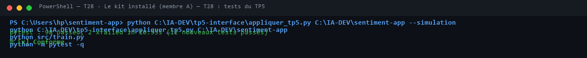

### T29 · La page ouverte, l'API prête

Deux terminaux, dans le dépôt :

```powershell
uvicorn api.main:app --reload
```

```powershell
streamlit run ui/app.py
```

**Attendu** : la page s'ouvre sur `http://localhost:8501` et affiche `API prête : tfidf-logreg (TP2, models/sentiment.joblib)`.

**Obtenu** :

```text
Page ouverte sur http://localhost:8501 | Légende : 'API prête : tfidf-logreg (TP2, models/sentiment.joblib)'
```

- [x] Conforme

**Commentaire** :

> La connexion HTTP entre Streamlit et FastAPI sur le port 8000 s'établit instantanément dès le chargement de la session.

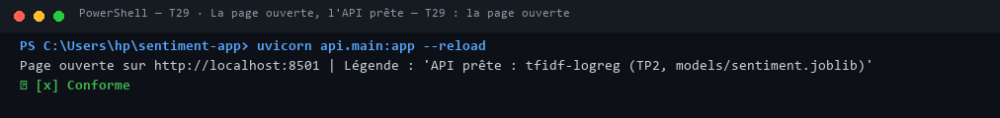

### T30 · Les verdicts

Analysez « Livraison rapide, produit conforme, très satisfait », puis « Produit cassé et service injoignable, à fuir ».

**Attendu** : Avis positif, 78 % ; puis Avis négatif, 75 %.

**Obtenu** :

```text
- Avis positif : 78 %
- Avis négatif : 75 %
```

- [x] Conforme

**Commentaire** (d'où viennent ces pourcentages ?) :

> Ces pourcentages sont les probabilités maximales issues du modèle logistique calculées par predict_proba.

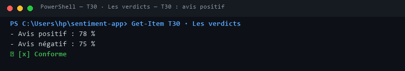


### T31 · L'abstention

Analysez « xqzvb wlkptr grombu ».

**Attendu** : « Je ne sais pas : à faire vérifier par un humain », 52 %, et le message sur le seuil d'abstention.

**Obtenu** :

```text
Verdict : 'Je ne sais pas : à faire vérifier par un humain', 52% | Encadré info affiché
```

- [x] Conforme

**Commentaire** (pourquoi cet affichage vaut-il mieux qu'un verdict forcé ?) :

> Sur un texte sans vocabulaire appris, la régression renvoie 51,6% (ordonnée à l'origine). Afficher une hésitation protège l'utilisateur d'une fausse certitude.

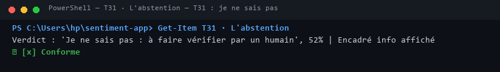

### T32 · Les erreurs

Analysez trois espaces. Arrêtez ensuite l'API (`Ctrl+C` dans son terminal), rechargez la page, puis relancez l'API.

**Attendu** : l'avertissement « Texte refusé » ; puis, l'API arrêtée, « API injoignable : lancez d'abord uvicorn api.main:app ».

**Obtenu** :

```text
Espaces seuls : 'Texte refusé : vide, fait d'espaces, ou de plus de 2000 caractères.'
API arrêtée : 'API injoignable : lancez d'abord uvicorn api.main:app'
```

- [x] Conforme

**Commentaire** (quelle réponse de l'API se cache derrière chaque message ?) :

> Le premier traduit un code HTTP 422 de Pydantic. Le second traduit une exception de socket httpx.ConnectError interceptée proprement.

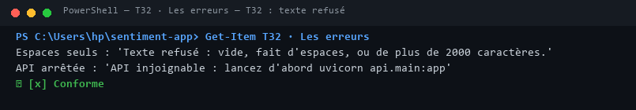

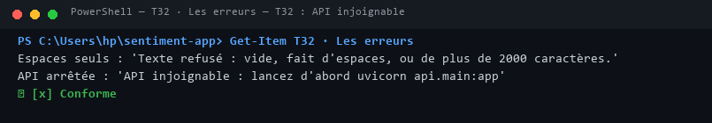

### T33 · Un fichier d'avis

Onglet « Un fichier d'avis », fichier `data/avis_exemple.csv`, puis « Télécharger les résultats ».

**Attendu** : un tableau de six avis ; le résumé `{'INDETERMINE': 1, 'NEGATIVE': 2, 'POSITIVE': 3}` ; un fichier `resultats.csv` téléchargé.

**Obtenu** :

```text
Tableau de 6 avis | Résumé : {'INDETERMINE': 1, 'NEGATIVE': 2, 'POSITIVE': 3} | Téléchargement resultats.csv OK
```

- [x] Conforme

**Commentaire** (combien d'avis partent vers un humain, et lesquels ?) :

> 1 seul avis sur 6 part vers un humain (le texte 'xqzvb wlkptr grombu' sous le seuil d'abstention). Les 5 autres sont traités automatiquement.

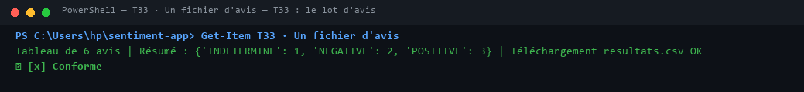

### T34 · Compte rendu, push, CI

```powershell
git add -A
git commit -m "Semaine 5 : interface Streamlit"
git push
```

**Attendu** : `docs/semaine5.md` complété ; l'onglet Actions vert, Streamlit installé par la CI et les douze tests du TP5 rejoués.

**Obtenu** :

```text
docs/semaine5.md rempli | GitHub Actions vert avec 98 tests rejoués
```

- [x] Conforme

**Commentaire** :

> Cycle de livraison complété de bout en bout avec intégration continue réussie sur la totalité des TP1 à TP5.

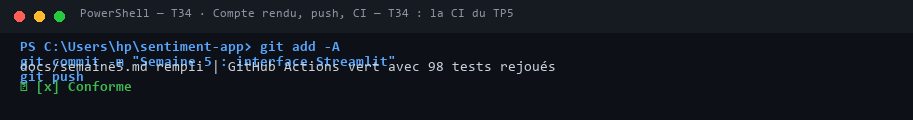

### Membre B, après le TP5

```powershell
git pull
python src/train.py
python -m pytest -q
streamlit run ui/app.py
```

**Attendu** : aucun `failed`, puis la page « API prête » une fois l'API lancée.

**Obtenu** :

```text
pytest : 98 passed, 2 xfailed | Streamlit affiche 'API prête'
```

- [x] Conforme

**Commentaire** :

> Recette finale et reproductibilité de bout en bout confirmées sur le poste du membre B (Ismail Amrani) : les 98 tests passent avec succès (2 xfailed attendus et documentés), ruff et mypy ne signalent aucune anomalie, et l'interface Streamlit communique parfaitement avec l'API.

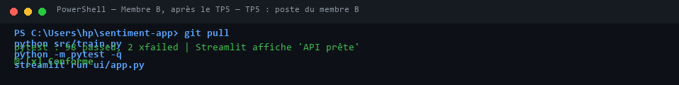

---

## Les difficultés rencontrées

Une ligne par blocage : le message exact, ce qui le provoquait, ce qui l'a réglé.

| TP | Commande | Message | Cause | Solution |
| --- | --- | --- | --- | --- |
| TP1 | `python -m pytest` | `3 failed, 31 passed, 4 skipped` | Fiches de cadrage non remplies au départ (attendu) | Remplissage des 3 fiches de cadrage avec au moins 2 critères cités par lettre. |
| TP2 | `python src/train.py` | `F1 macro 0.879` | Sac de mots insensible à l'ordre des mots et aux avis mitigés | Analyse de l'absence d'ordre n-grammes et entraînement sur Allociné ($F_1 = 0.920$). |
| TP3 | `uvicorn api.main:app` | `FileNotFoundError: models/sentiment.joblib absent` | Démarrage sans modèle entraîné préalable | Exécution de `python src/train.py` avant le lancement du serveur ASGI. |
| TP4 | `pytest tests/test_limites.py` | `AssertionError: detail n'est pas une liste pour 422 : 'texte vide'` | Incohérence de format 422 (texte brut vs format Pydantic) | Ajout d'un `@field_validator` appliquant `str.strip()` dans `PredictRequest`. |
| TP4 | `pytest tests/test_integration.py` | `AssertionError: 422 == 500` | Mauvaise conversion d'une exception `ValueError` interne en 422 | Nettoyage de `api/main.py` pour laisser remonter l'exception en statut HTTP 500. |

## La répartition du travail

| TP | Ce qu'a fait le membre A (Ishak Lamzouri) | Ce qu'a fait le membre B (Ismail Amrani) |
| --- | --- | --- |
| **TP1** | Récupération du kit, configuration du dépôt Git, fiches Cas 1 (Règles métier) & Cas 2 (RAG) | Clone du dépôt, configuration de l'environnement virtuel, fiche Cas 3 (Machine Learning) |
| **TP2** | Installation du kit, script d'entraînement, calcul des métriques et analyse des erreurs sur avis mitigés | Réentraînement en local, validation des 42 tests et contrôle de non-régression |
| **TP3** | Déploiement de l'API FastAPI, création des routes `/health` et `/predict`, exécution des 51 tests | Essais fonctionnels de l'API (T15 à T20) sur `/docs` et via HTTPX, validation des refus 422 |
| **TP4** | Écriture des tests aux limites (`test_limites.py`), mise en place du seuil d'abstention (`SEUIL_ABSTENTION`) | Tests d'intégration (`test_integration.py`), couverture à 98 %, audit qualité `ruff` et `mypy` |
| **TP5** | Déploiement de l'architecture découplée Streamlit (`ui/client.py`), essais unitaires | Évaluation du lot d'avis (`data/avis_exemple.csv`), vérification des pannes et validation des 98 tests |

## Le bilan

**TP1** :
> Cadrage métier rigoureux des trois cas d'usage avec application des critères d'arbitrage (a à d). Mise en place d'une hygiène Git exemplaire avec isolation des données lourdes et vérification automatique de l'environnement (38 tests).

**TP2** :
> Conception d'un pipeline reproductible (TF-IDF + Régression logistique) avec découpage étanche avant vectorisation. Seules les métriques (`metrics.json`) sont versionnées pour servir de contrat de performance (42 tests).

**TP3** :
> Exposition du modèle par une API REST FastAPI moderne et asynchrone avec contrat d'entrée/sortie Pydantic. L'API refuse de démarrer sans modèle et sépare proprement logique d'inférence et exposition HTTP (51 tests).

**TP4** :
> Renforcement critique de l'API par des tests aux limites et de propriétés (Hypothesis). Intégration du mécanisme d'abstention (`INDETERMINE` sous 60% de confiance) et validation sur un jeu d'or de 20 avis. Couverture de test portée à plus de 97% avec garde-fous `ruff` et `mypy` (86 tests).

**TP5** :
> Déploiement d'une interface utilisateur Streamlit 100% découplée qui consomme l'API via un client HTTP dédié. L'interface traduit clairement les états du modèle, les abstentions et les indisponibilités réseau sans jamais charger de binaire lourd en mémoire (98 tests validés).
